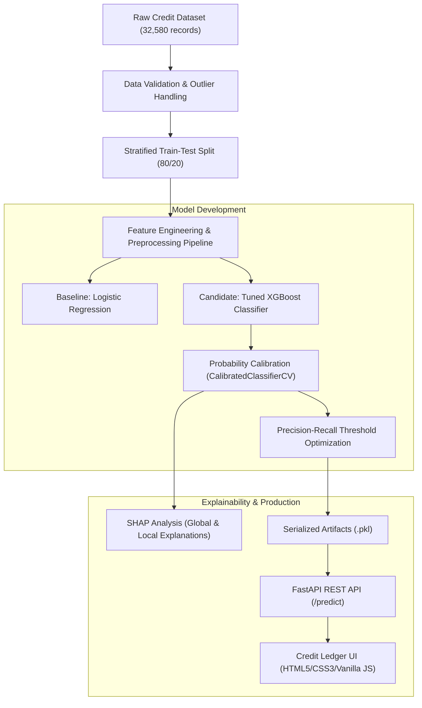

# Credit Risk Assessment & Explainability with SHAP 🏦📊

[](https://www.python.org/)
[](https://fastapi.tiangolo.com/)
[](https://xgboost.readthedocs.io/)
[](https://scikit-learn.org/)
[](https://shap.readthedocs.io/)
[](LICENSE)

An end-to-end Machine Learning system for **Credit Default Prediction** coupled with **Explainable AI (SHAP)**. The project features an exploratory data science pipeline, probability calibration, threshold optimization, a high-performance **FastAPI** backend, and an interactive **Credit Underwriting Desk UI** that runs locally from your terminal.

---

## 📌 Executive Summary & Business Context

In credit lending, the cost of misclassification is highly asymmetric:
- **False Negative (Type II error)**: Approving a borrower who subsequently defaults incurs severe financial losses (often 100% of the principal loan amount).
- **False Positive (Type I error)**: Rejecting a creditworthy borrower results only in the opportunity cost of forgone interest.

Furthermore, financial regulations (such as the Equal Credit Opportunity Act and GDPR's *Right to Explanation*) mandate that credit decisions cannot be a "black box." Lenders must provide clear, adverse-action explanations for why an applicant was flagged as high risk.

This project solves both problems:
1. **High-Performance Modeling**: Trains and tunes an **XGBoost** classification pipeline with threshold optimization to minimize default losses.
2. **Model Interpretability (XAI)**: Leverages **SHAP (SHapley Additive exPlanations)** values to generate global feature importance and granular, applicant-level local waterfall explanations.
3. **Interactive Underwriting App**: Provides an institutional-grade web interface for credit underwriters to test borrower profiles and inspect default probabilities in real time.

---

## 🏗️ System Architecture



---

## 📂 Project Structure

```text
Credit-Risk-Assesment-using-SHAP/
├── Credit_Risk.ipynb           # Complete Data Science & SHAP analysis notebook
├── credit_risk_dataset.csv     # Historical borrower dataset
├── credit_risk_model.pkl       # Serialized trained model pipeline
├── best_threshold.pkl          # Empirically optimized decision threshold
├── main.py                     # FastAPI application & REST endpoint
├── requirements.txt            # Python dependencies
└── static/                     # Underwriting Web Dashboard
    ├── index.html              # Clean underwriting ledger interface
    ├── style.css               # Modern typography & responsive layout
    └── script.js               # Client-side form handler & API connector
```

---

## 🔬 Machine Learning Pipeline

### 1. Data Cleaning & Validation
- **Missing Value Imputation**: Median imputation for employment length and interest rates using column transformers.
- **Outlier Filtering**: Domain-specific sanity bounds (e.g., removing impossible borrower ages $> 100$ and invalid employment durations).
- **Handling Class Imbalance**: Stratified sampling and threshold tuning to handle default minority distribution without distorting calibration.

### 2. Model Training & Comparison
- **Baseline**: Regularized Logistic Regression with One-Hot & StandardScaler pipelines.
- **Final Model**: Tuned **XGBoost Classifier** optimized for ROC-AUC and Precision-Recall characteristics.
- **Probability Calibration**: Uses calibration curves to ensure predicted probabilities match real-world default frequencies.

### 3. Classification Threshold Optimization
Instead of defaulting to an arbitrary $0.5$ decision threshold, the decision boundary was dynamically optimized to minimize expected business loss, balancing precision against default recall.

### 4. Explainable AI (SHAP)
- **Global Interpretability**: Evaluates overall model drivers using Beeswarm and Feature Importance summary plots (Loan-to-income ratio, interest rate, and historical credit default emerge as top risk drivers).
- **Local Interpretability**: Provides individual credit waterfall plots showing the exact push-and-pull contributions of each attribute toward the final default probability.

---

## ⚡ API Specification

The FastAPI microservice runs on asynchronous endpoints and validates all input requests using Pydantic.

### `POST /predict`
Evaluates a loan applicant's parameters and returns the default probability and risk tier.

#### **Request Body**
```json
{
  "person_age": 30,
  "person_income": 60000.0,
  "person_home_ownership": "RENT",
  "person_emp_length": 5.0,
  "loan_intent": "PERSONAL",
  "loan_grade": "D",
  "loan_amnt": 15000.0,
  "loan_int_rate": 14.5,
  "loan_percent_income": 0.25,
  "cb_person_default_on_file": "N",
  "cb_person_cred_hist_length": 6
}
```

#### **Response Body**
```json
{
  "default_probability": 0.684,
  "default_prediction": 1,
  "threshold": 0.38,
  "Result": "High Risk"
}
```

Interactive OpenAPI Swagger documentation is available out of the box at `http://localhost:8000/docs`.

---

## 💻 Running Locally from Terminal

### Prerequisites
- Python 3.10+ (Recommended: Python 3.12)
- Git

### 1. Clone the Repository
```bash
git clone https://github.com/sanyam-pro/Credit-Risk-Assesment-using-SHAP.git
cd Credit-Risk-Assesment-using-SHAP
```

### 2. Create and Activate Virtual Environment
```bash
# Windows
python -m venv .venv
.venv\Scripts\Activate.ps1

# Linux / macOS
python3 -m venv .venv
source .venv/bin/activate
```

### 3. Install Dependencies
```bash
pip install -r requirements.txt
```

### 4. Start the Application
Run the FastAPI development server from your terminal:
```bash
uvicorn main:app --reload --host 127.0.0.1 --port 8000
```

Once running, access the interfaces directly in your browser:
- **Interactive Underwriting Dashboard**: [http://127.0.0.1:8000](http://127.0.0.1:8000)
- **Interactive API Documentation (Swagger)**: [http://127.0.0.1:8000/docs](http://127.0.0.1:8000/docs)

---

## 👤 Author

**Sanyam Girdhar**
- GitHub: [@sanyam-pro](https://github.com/sanyam-pro)
- Email: [sanyamgirdhar99@gmail.com](mailto:sanyamgirdhar99@gmail.com)

---

## 📄 License

This project is licensed under the MIT License — see the repository for details.
